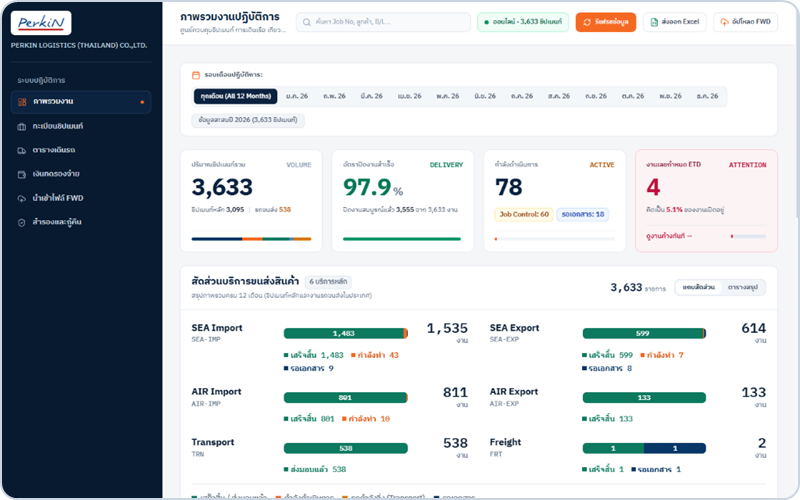
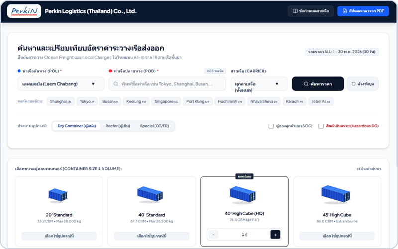
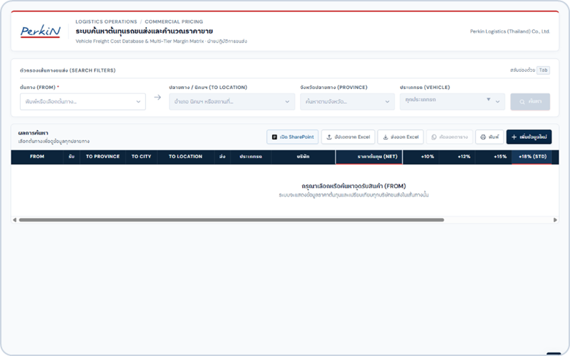

  

 

Hi! I'm **Suthipong Pikulyam (Dodge)** — a Computer Science graduate from **Rangsit University (2026)** based in Bangkok. I build web apps, mobile apps, and practical AI tools for logistics, finance, and everyday workflows.

สวัสดีครับ ผม **ดอส (สุทธิพงษ์ พิกุลแย้ม)** จบวิทยาการคอมพิวเตอร์ ม.รังสิต (2026) ชอบสร้างเว็บแอป แอปมือถือ และระบบที่ใช้ AI ช่วยลดงานซ้ำซ้อนในชีวิตจริง

- **Education:** B.S. in Computer Science (Digital Innovation Technology), Rangsit University · 2026
- **Languages:** English (Fluent), Thai (Intermediate)
- **Contact:** [suthipong2003dos@gmail.com](mailto:suthipong2003dos@gmail.com)

---

### Now

- Building internal logistics pricing & shipment tools with **Next.js**, **PostgreSQL / Supabase**, and **Gemini AI**
- Exploring practical structured PDF / slip extraction to replace manual spreadsheet work
- Open to **Full-Stack**, **Frontend**, or **AI Application Developer** roles in Bangkok / Remote

---

### Live Projects

<table>
  <tr>
    <td width="33.3%" valign="top">
      
       
      <strong><a href="https://github.com/Suthipong25/Perkin-Logistics-Dashboard">Perkin Logistics Dashboard</a></strong> · <a href="https://perkin-logistics-dashboard-suthipongs-projects-2d06d15d.vercel.app/">Live ↗</a>
       
      Shipment, customs &amp; fleet tracking hub for operations, CS, and finance.
       
      <code>Next.js</code> <code>PostgreSQL</code> <code>Supabase</code> <code>Python</code>
    </td>
    <td width="33.3%" valign="top">
      
       
      <strong><a href="https://github.com/Suthipong25/Export_Oversea_Cost">Export Oversea Cost</a></strong> · <a href="https://exportoverseacost.vercel.app">Live ↗</a>
       
      All-in sea freight rate comparator across 18 carriers &amp; 600+ ports with AI PDF parsing.
       
      <code>Next.js</code> <code>TypeScript</code> <code>Supabase</code>
    </td>
    <td width="33.3%" valign="top">
      
       
      <strong><a href="https://github.com/Suthipong25/Cost_price_search_system">Vehicle Cost Search</a></strong> · <a href="https://costpricesearchsystem.vercel.app">Live ↗</a>
       
      Route &amp; truck cost lookup with lowest-rate highlight, 10–30% margin &amp; Excel sync.
       
      <code>React</code> <code>Express</code> <code>PostgreSQL</code> <code>XLSX</code>
    </td>
  </tr>
</table>

---

### More Projects

- **[MoneyMate](https://github.com/Suthipong25/MoneyMate)** — Income & expense app with customer/admin portals. Reads Thai bank slips and tax invoices via Gemini AI, flags duplicates, extracts 7% VAT, and exports Excel reports. `Next.js` · `TypeScript` · `Supabase` · `Gemini API` · `ExcelJS`
- **[Foodcal](https://github.com/Suthipong25/Foodcal)** — Cross-platform mobile app for AI food analysis, calorie & macro tracking, water intake, workout history, and a Thai-language AI coach. `Flutter` · `Dart` · `Firebase`
- **[Import Oversea Cost](https://github.com/Suthipong25/import_oversea_cost)** — Overseas agent cost comparison (FCL/LCL), margin approval workflow, and automated PDF quotations with AI charge extraction.
- **[Bistro Landing Page](https://github.com/Suthipong25/landing-page)** — Responsive restaurant landing page with category filtering, interactive review carousels, and contact forms. `React` · `Tailwind CSS` · `Vite`
- **[Velora Hotel](https://github.com/Suthipong25/velorahotel)** — Hotel booking web app with a React/Tailwind frontend and Node.js/Express REST API. `React` · `Node.js` · `Express`
- **CV2 ScanFace** *(Computer Vision Project)* — Real-time face detection and recognition built with Python, OpenCV, and HTML/CSS. `Python` · `OpenCV`

---

### Experience

**GenInflu** ([geninflu.co](https://geninflu.co)) — *Full Stack Developer Intern* `Jan 2026 – May 2026`
- Built the brand pricing & package comparison page so teams can compare plans clearly.
- Developed a shareable brand campaign report feature for presenting results to executives.
- Created a Sales Demo Mode with demo accounts for sales presentations and client onboarding.
- Implemented a fast registration flow letting influencers sign up in under 30 seconds.

---

### Skills & Tools

**Languages**

<picture>
  <source media="(prefers-color-scheme: dark)" srcset="https://skillicons.dev/icons?i=ts%2Cjs%2Cpy%2Cdart%2Cjava%2Ccs%2Cphp%2Chtml%2Ccss&theme=dark" />
  <source media="(prefers-color-scheme: light)" srcset="https://skillicons.dev/icons?i=ts%2Cjs%2Cpy%2Cdart%2Cjava%2Ccs%2Cphp%2Chtml%2Ccss&theme=light" />
  
</picture>

**Frontend & Mobile**

<picture>
  <source media="(prefers-color-scheme: dark)" srcset="https://skillicons.dev/icons?i=nextjs%2Creact%2Cflutter%2Cangular%2Ctailwind%2Cvite&theme=dark" />
  <source media="(prefers-color-scheme: light)" srcset="https://skillicons.dev/icons?i=nextjs%2Creact%2Cflutter%2Cangular%2Ctailwind%2Cvite&theme=light" />
  
</picture>

**Backend & Databases**

<picture>
  <source media="(prefers-color-scheme: dark)" srcset="https://skillicons.dev/icons?i=nodejs%2Cexpress%2Cdotnet%2Cpostgres%2Csupabase%2Cfirebase%2Cmysql%2Cmongodb&theme=dark" />
  <source media="(prefers-color-scheme: light)" srcset="https://skillicons.dev/icons?i=nodejs%2Cexpress%2Cdotnet%2Cpostgres%2Csupabase%2Cfirebase%2Cmysql%2Cmongodb&theme=light" />
  
</picture>

**Tools & Vision**

<picture>
  <source media="(prefers-color-scheme: dark)" srcset="https://skillicons.dev/icons?i=opencv%2Cgit%2Cgithub%2Cdocker%2Cfigma%2Cpostman%2Cvscode&theme=dark" />
  <source media="(prefers-color-scheme: light)" srcset="https://skillicons.dev/icons?i=opencv%2Cgit%2Cgithub%2Cdocker%2Cfigma%2Cpostman%2Cvscode&theme=light" />
  
</picture>

Also using: `Google Gemini API (@google/genai)` · `SQL / PLpgSQL` · `ExcelJS / XLSX` · `Trello`

---

  <picture>
    <source media="(prefers-color-scheme: dark)" srcset="https://raw.githubusercontent.com/Suthipong25/Suthipong25/output/github-contribution-grid-snake-dark.svg" />
    <source media="(prefers-color-scheme: light)" srcset="https://raw.githubusercontent.com/Suthipong25/Suthipong25/output/github-contribution-grid-snake.svg" />
    
  </picture>

