<picture>
  <source media="(prefers-color-scheme: dark)" srcset="./assets/banner-dark.svg" />
  <source media="(prefers-color-scheme: light)" srcset="./assets/banner-light.svg" />
  
</picture>

 

### About Me · เกี่ยวกับผม

I am **Suthipong (Dodge)**, a **Full-Stack & AI Software Engineer** focused on shipping production-grade web applications, mobile apps, and AI-powered workflow automation. My recent work centers on **Enterprise Logistics Platforms**, **FinTech SaaS**, and **Multimodal AI Document Extraction** — turning complex spreadsheets, PDFs, and manual operations into reliable, auditable software.

ผมเป็น **Full-Stack & AI Software Engineer** ที่เน้นสร้างระบบที่ใช้งานจริงในธุรกิจ ทั้ง Web Application, Mobile App และระบบ AI Automation โดยเชี่ยวชาญด้านระบบปฏิบัติการ **Logistics**, **FinTech SaaS** และการนำ **Google Gemini Multimodal AI** มาอ่านเอกสาร/สลิป/PDF เพื่อลดงานซ้ำซ้อนและเพิ่มความแม่นยำให้กับทีมปฏิบัติการและผู้บริหาร

  
  
  

---

### Featured Projects · ผลงานเด่น

| Project | Highlights & Business Impact | Tech Stack | Links |
| :--- | :--- | :--- | :---: |
| **[MoneyMate](https://github.com/Suthipong25/MoneyMate)** AI-Powered Income & Expense SaaS | Multi-role SaaS (`Customer` & `Super Admin` portals) powered by **Gemini Multimodal AI** to scan bank slips, receipts, and tax invoices. Built with 2-tier duplicate detection, automated VAT 7% extraction, atomic credit ledger, PromptPay top-up, and 5-sheet formula-driven Excel exports. ระบบ SaaS จัดการรายรับ-รายจ่าย สแกนสลิป/ใบกำกับภาษีด้วย Gemini AI พร้อมตรวจสลิปซ้ำ ถอด VAT 7% และส่งออกงบ Excel อัตโนมัติ | `Next.js 15` `TypeScript` `Gemini AI` `Supabase` `PostgreSQL` `ExcelJS` | [Repo](https://github.com/Suthipong25/MoneyMate) |
| **[Perkin Logistics Dashboard](https://github.com/Suthipong25/Perkin-Logistics-Dashboard)** Operations & Shipment Control Hub | Enterprise shipment, customs clearance, and fleet tracking control center built for Operations, Customer Service, Finance, and Management teams — centralizing real-time status and operational data. ศูนย์กลางควบคุมสถานะงานขนส่ง พิธีการศุลกากร และเที่ยวรถ สำหรับทีมปฏิบัติการ บัญชี และผู้บริหาร | `Next.js 14` `TypeScript` `PostgreSQL` `Supabase` `Python` `Tailwind CSS` | [Live](https://perkin-logistics-dashboard-suthipongs-projects-2d06d15d.vercel.app/) · [Repo](https://github.com/Suthipong25/Perkin-Logistics-Dashboard) |
| **[Export](https://github.com/Suthipong25/Export_Oversea_Cost) & [Import Oversea Cost](https://github.com/Suthipong25/import_oversea_cost)** AI Freight Rate & Quotation Systems | All-in sea freight & overseas agent cost comparison platforms (FCL/LCL) featuring **AI extraction of rate tables & remarks from PDFs**, margin approval workflows, and automated PDF quotation generation. ระบบสืบค้นเปรียบเทียบค่าระวางเรือและต้นทุน Agent พร้อม AI ดึงตารางราคาจาก PDF ขออนุมัติราคา และออกใบเสนอราคาอัตโนมัติ | `Next.js 16` `TypeScript` `Supabase` `AI PDF Parsing` | [Export](https://github.com/Suthipong25/Export_Oversea_Cost) · [Import](https://github.com/Suthipong25/import_oversea_cost) |
| **[Vehicle Cost Search System](https://github.com/Suthipong25/Cost_price_search_system)** Logistics Route Cost & Margin Engine | Real-time route & truck-type cost comparator that automatically highlights lowest-cost carriers, calculates tiered selling margins (10%–30%), and syncs seamlessly with Excel/SharePoint. ระบบเปรียบเทียบต้นทุนรถขนส่งตามเส้นทาง ไฮไลต์ราคาต่ำสุด คำนวณ Margin 10–30% และเชื่อมต่อ Excel/SharePoint | `React` `Vite` `Node.js` `Express` `PostgreSQL` `XLSX` | [Repo](https://github.com/Suthipong25/Cost_price_search_system) |
| **[Foodcal](https://github.com/Suthipong25/Foodcal)** Cross-Platform Health & AI Coach App | Cross-platform mobile app for daily meal/water logging, macro & calorie tracking, weight history charts, workout videos, and a Thai-language **AI Health Coach**. แอปมือถือดูแลสุขภาพ บันทึกอาหาร/น้ำ คำนวณแคลอรี่ ดูวิดีโอออกกำลังกาย และคุยกับ AI Coach ภาษาไทย | `Flutter` `Dart` `Firebase` `Cloud Firestore` `AI Coach` | [Repo](https://github.com/Suthipong25/Foodcal) |
| **[Velora Hotel](https://github.com/Suthipong25/velorahotel)** Full-Stack Hotel Booking System | Decoupled hotel reservation platform with a clean React/Tailwind frontend and Node.js/Express REST API backend. ระบบจองโรงแรมแบบแยก Frontend และ REST API Backend | `React` `Vite` `Tailwind CSS` `Node.js` `Express` | [Repo](https://github.com/Suthipong25/velorahotel) |

---

### Engineering Stack · เทคโนโลยีที่ใช้งานจริง

| Layer | Technologies |
| :--- | :--- |
| **Frontend & Mobile** |        |
| **Backend & Database** |       |
| **AI & Automation** |    |
| **Cloud & Tooling** |     |

---

### How I Build · แนวทางการทำงาน

- **End-to-End Ownership** — From PostgreSQL/PLpgSQL schema design, Row-Level Security, and API architecture to responsive UI and production deployment.
- **Practical Applied AI** — Using structured JSON schemas with Multimodal LLMs to solve messy real-world documents (Thai bank slips, VAT invoices, carrier freight PDFs) with verification & audit trails.
- **Documentation & Maintainability** — Shipping systems alongside clear Product, Developer, and User Guides so teams can operate and scale confidently.

---

  Open to Full-Stack, AI Engineering, and Product Engineering roles · Bangkok, Thailand

